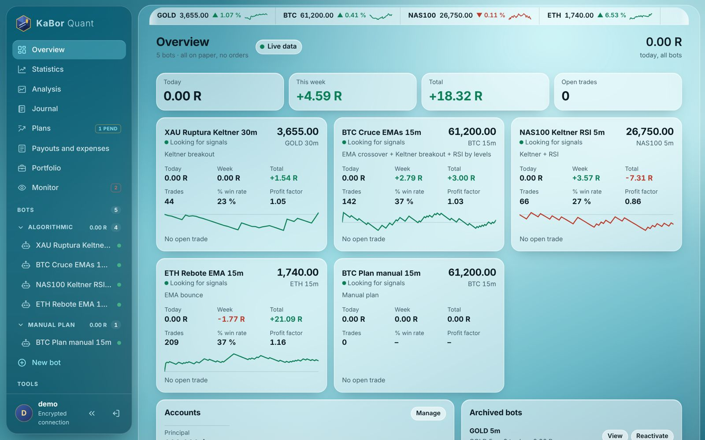

# KaBor Quant

**Modular trading system for MyFundedPerps · Powered by Claude via MCP**

<p align="center"></p>

**[Read the full guide →](docs/GUIDE.md)** · [PDF version](docs/KaBor_Quant_Builders_Guide.pdf)

Self-hosted trading-bot platform for **MyFundedPerps (MFP) sandbox accounts**:

- many strategy bots on one Raspberry Pi or any Linux machine;
- paper trading, or sandbox execution through the MFP API and account stream;
- a web panel with login and HTTPS, in Spanish, English and French;
- Telegram alerts with charts;
- **SMT**, an MCP connector that lets Claude read the bots and your chart drawings and draft trade plans that you confirm in the panel.

> **Independent project, not affiliated with or endorsed by MyFundedPerps.**

**Sandbox only.** The client refuses `fp_live_` keys and any host other than `sandbox.myfundedperpetuals.com`.
Nothing here is financial advice or a promise of profits or challenge passes. Backtest and paper results do
not guarantee future results. Example strategies are for learning; backtest them before you trade them.

## Big update: 9.x

The biggest change since 8.x: **a bot can run several strategies at once.**

- **One trade at a time.** The first valid signal opens the trade and blocks the others until it closes by TP, SL, the strategy's exit or manually.
- **Own settings per strategy.** Each strategy has its own timeframe, settings and direction (both sides, longs only or shorts only).
- **Automatic priority.** Each strategy gets a score from its own backtest (SQN), and the best score wins when two signal on the same candle.
- **Per-strategy performance** and a **backtest breakdown** with a timeline of every signal: entered, blocked, filtered.
- **Laptop analysis script.** `herramientas/analizar_estrategias.py` tests each strategy alone, the bot without each one, every direction and every priority order.
- **Analysis chart** with levels, FVG zones and a TradingView-style position tool. It turns into a manual plan in one click, and Claude reads it through SMT.
- **MFP account stream** instead of REST polling, with a per-key read limiter.
- **Built-in help** in three languages, with screenshots.

See [what's new](docs/GUIDE.md#big-update-whats-new-in-9x) for details.

## MFP API usage

- Market data comes from the MFP market WebSocket. Orders, fills and positions come from the **account stream**
  (`/v1/sandbox/stream`, one connection per key, with resume). REST is only a fallback while it reconnects.
- Each key stays under 24 GET requests per minute (MFP's sandbox limit is 30). A 429 pauses every read on that key
  for the full `Retry-After`, and `X-RateLimit-Warning` headers are logged and sent to Telegram.
- Every order carries a fixed `Idempotency-Key`, so retries never duplicate an order.
- API keys stay in `data/cuentas.json` (owner-only) and never appear in URLs, logs or the panel (last 4 characters only).

## Requirements

Any Linux machine with **Python 3.9 or newer**: a Raspberry Pi 3 or newer (the reference setup, cheap and low-power,
always on), a PC or mini PC, a home server, a VPS, or WSL on Windows. `install.sh` sets everything up on
Debian, Ubuntu and their derivatives. Run only one copy with the same accounts.

## Quick start (Raspberry Pi OS / Debian / Ubuntu)

```
unzip kabor_quant_publico_*.zip && cd kabor_quant
chmod +x install.sh bot.sh
./install.sh              # virtualenv, dependencies and system service
./bot.sh usuario          # panel user (password stored as a scrypt hash)
./bot.sh configurar       # answer 1 to HTTPS
./bot.sh comprobar        # checks everything, sends no orders
./bot.sh reiniciar && ./bot.sh panel
```

Then: panel → Accounts → add your `fp_test_` key (MFP → Settings → API Keys, Test, Read And Trade).

## Strategies

A strategy is one `.py` file in `estrategias/`. Start with `estrategias/cruce_emas.py` (EMA crossover, fully
commented) and read `ESTRATEGIAS.md`. Test any file on real MFP candles without installing it:

```
./bot.sh probar estrategias/cruce_emas.py --simbolo BTC --tf 15m --dias 60
```

The [full guide](docs/GUIDE.md) covers architecture, installation, several strategies per bot, the SMT connector
and risk controls. The panel's built-in Help (Spanish, English, French) and the Spanish docs (`LEEME.md`,
`ESTRATEGIAS.md`) cover every setting in detail.

## License

Copyright 2026 Borislav Vladimirov Petrakiev. Licensed under the [Apache License 2.0](LICENSE): free to use,
modify and redistribute, including commercially, keeping the `NOTICE` file and the copyright notices.
The "KaBor Quant" name and logo are not licensed for other products: forks must use their own (see `NOTICE`).
