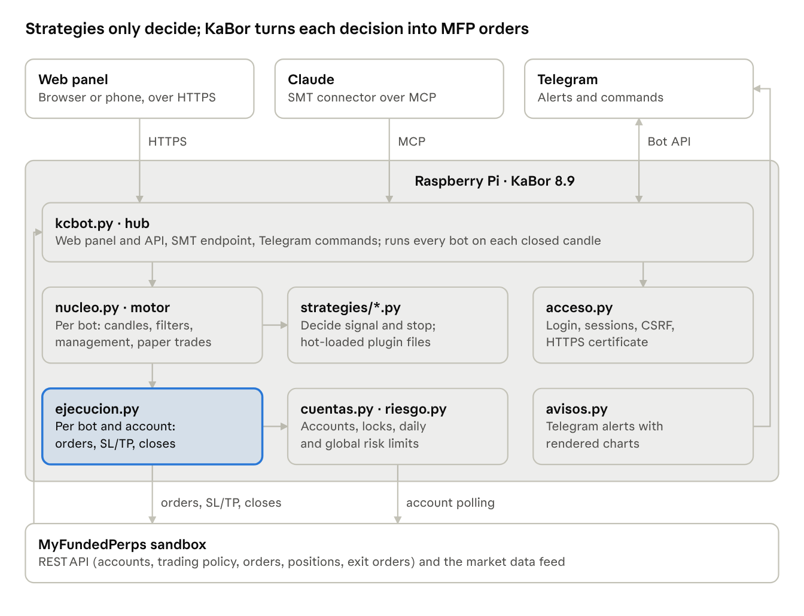
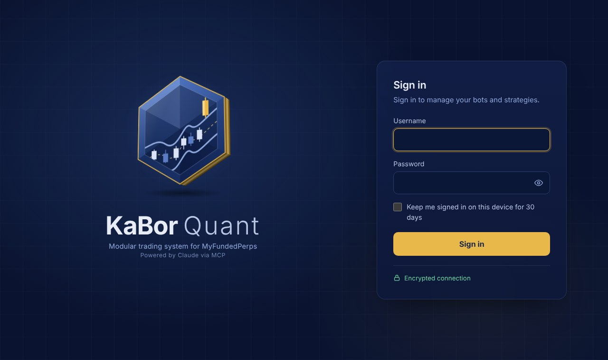
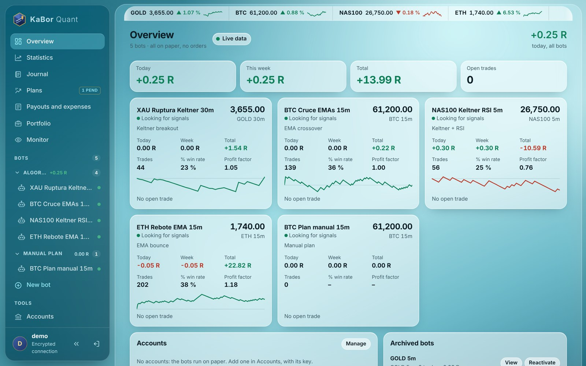
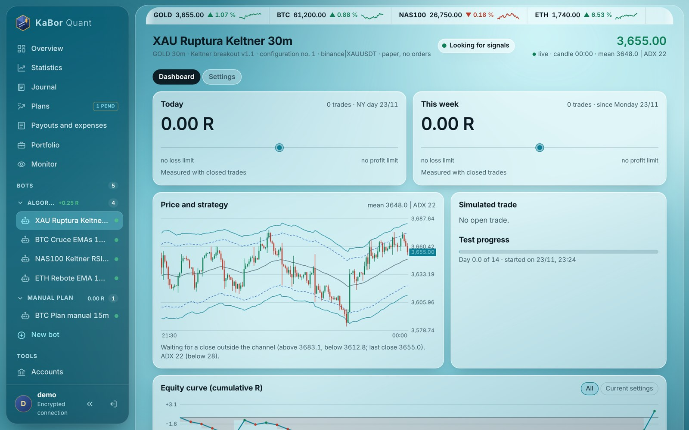
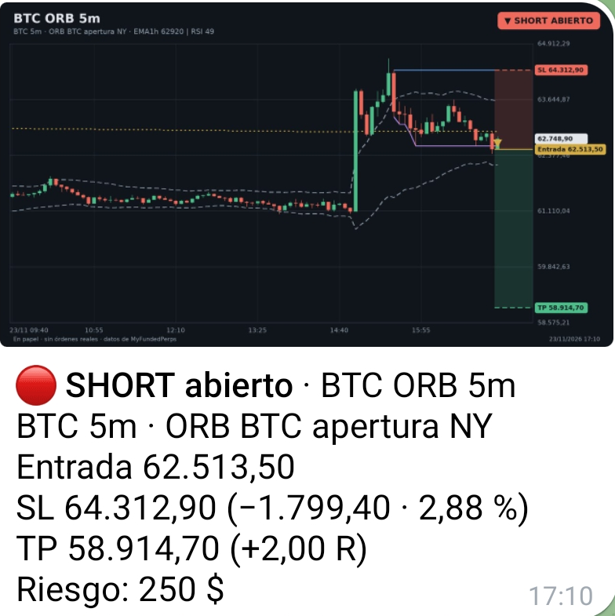
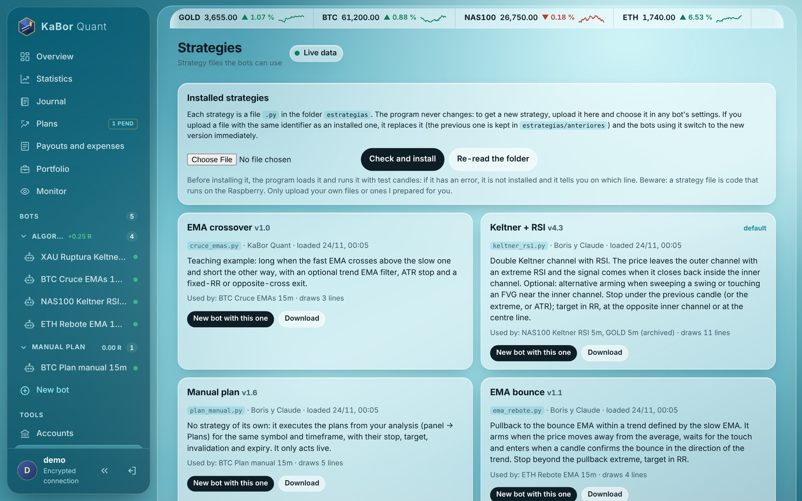
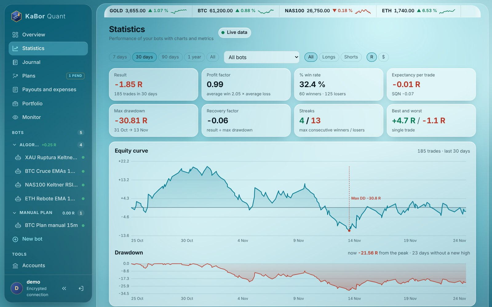
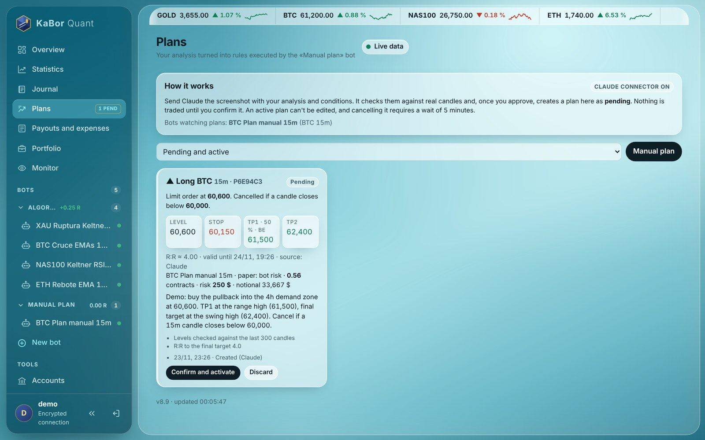

# KaBor Quant — Builder's Guide for MyFundedPerps


**Contents**

- [Overview](#overview)
- [Architecture](#architecture)
- [Installation on a Raspberry Pi](#installation-on-a-raspberry-pi)
- [Connecting a MyFundedPerps sandbox account](#connecting-a-myfundedperps-sandbox-account)
- [Panel and Telegram alerts](#panel-and-telegram-alerts)
- [Example strategy: Keltner Breakout](#example-strategy-keltner-breakout)
- [How to create your own strategy](#how-to-create-your-own-strategy)
- [Workflow: backtest → paper → sandbox](#workflow-backtest--paper--sandbox)
- [SMT: the MCP connector for Claude](#smt-the-mcp-connector-for-claude)
- [Risk and safety controls](#risk-and-safety-controls)
- [Roadmap](#roadmap)

## Overview

KaBor Quant is a self-hosted trading-bot platform for MyFundedPerps (MFP). It runs many strategy bots at once on a Raspberry Pi, trades them on paper or in MFP sandbox accounts through the REST API, and lets Claude read the bots and propose trades through its own MCP server, called SMT.

**Modular trading system for MyFundedPerps · Powered by Claude via MCP.** Version 8.9 runs 24/7 on a Raspberry Pi, with 8 bots on BTC, ETH, XAU, NAS100 and CRWV and 15 strategies installed.

*Independent project, not affiliated with or endorsed by MyFundedPerps. Sandbox only. Nothing here is financial advice or a promise of profits or challenge passes; backtest and paper results do not guarantee future results.*

**Source code:** [github.com/borisvp1982-oss/kabor-quant](https://github.com/borisvp1982-oss/kabor-quant) (Apache License 2.0).

**What it does**

- **Real-time data from MFP.** Every bot runs on closed candles from the MFP market feed, so backtests, paper trading and sandbox execution all use the same prices.

- **Pluggable strategies.** A strategy is a single `.py` file that only decides when to enter and where the stop goes. Everything else is shared: entries, filters, trade management, limits and stats.

- **Paper → sandbox with one switch.** The same signals, stops and targets become real orders in one or more MFP sandbox accounts, each with its own API key and risk multiplier.

- **Prop-firm risk layer.** Before every order it checks the trading policy and the remaining daily loss. It adds account lockouts, global daily and weekly limits, and a guard on idempotency keys so a retry never duplicates an order.

- **Web panel.** Login, HTTPS, statistics, backtester, Monte Carlo and prop-challenge simulator, walk-forward optimizer, and UI languages.

- **Telegram alerts** with a rendered chart for every signal, entry and exit, plus commands such as `/cuentas` and `/bloquear`.

- **SMT, the MCP connector.** Claude can read bots, trades and stats, check candles, and draft manual trade plans. The trader confirms each plan in the panel before anything runs.

**MFP surfaces used:** REST API (accounts, trading policy, markets, quotes, orders, positions, exit orders, close-all, cancel-all) in **sandbox only**. Keys must start with `fp_test_`, and any host other than `sandbox.myfundedperpetuals.com` is refused.

**Who it is for:** funded traders who have a rule-based edge but lose it in execution. KaBor turns the rules into code, runs them without emotion, and enforces the prop firm's limits before the firm has to.

## Architecture

KaBor is one Python process with seven modules. Strategies never touch the network: the engine feeds them closed candles, and only `ejecucion.py` talks to the MFP trading endpoints.



Each closed candle flows top to bottom: the hub hands it to every bot's engine, the strategy decides, the engine manages the paper trade, and the executor mirrors it in each sandbox account after the account and risk checks pass.

## Installation on a Raspberry Pi

KaBor Quant installs in about five minutes on any Raspberry Pi 3 or newer running Raspberry Pi OS. It needs only Python 3, `websocket-client` and `pillow`, and runs as a system service that restarts by itself.

1.  Copy the release zip to the Pi and unpack it:

        cd ~
        unzip kabor_quant.zip
        cd kcbot2
        chmod +x install.sh bot.sh
        ./install.sh

2.  Create the panel user (password of 10+ characters, stored only as a scrypt hash):

        ./bot.sh usuario

3.  Run the setup wizard and answer `1` to "Panel por HTTPS". A self-signed certificate is created in `data/tls/`.

        ./bot.sh configurar
        ./bot.sh comprobar     # every line should read [ok]
        ./bot.sh reiniciar
        ./bot.sh panel         # prints the panel address

4.  Open the address in a browser and sign in.

**Remote access.** Never open the panel port on your router. Use Tailscale instead: `sudo tailscale serve --bg <port>` gives a clean `https://<name>.<tailnet>.ts.net` address with no browser warning.

**Daily commands**

| Command                    | What it does                                                         |
|----------------------------|----------------------------------------------------------------------|
| `./bot.sh logs`            | Live log of every bot                                                |
| `./bot.sh estado`          | Is the service running                                               |
| `./bot.sh reiniciar`       | Restart all bots                                                     |
| `./bot.sh comprobar`       | Checks feed, strategies, charts, accounts and HTTPS; sends no orders |
| `./bot.sh probar FILE`     | Backtests a strategy file on real MFP candles without installing it  |
| `./bot.sh informe`         | ZIP report of every bot                                              |
| `./bot.sh cerrar-sesiones` | Logs out every device (lost phone)                                   |

## Connecting a MyFundedPerps sandbox account

One `fp_test_` key is enough to connect every sandbox account you own; each bot then picks which accounts it trades.

1.  **Create a test key.** MyFundedPerps → Settings → API Keys → Create API Key, environment **Test (Sandbox)**, level **Read And Trade**. If you have no sandbox account yet, one is created with \$100,000. You can create up to 10 sandbox accounts there; the key sees all of them.

2.  **Add the account in KaBor.** Panel → **Cuentas** (Accounts) → Add account: a name, the key, then "Find this key's accounts" and pick one. Set a **risk multiplier** if needed (0.5 = half the bot's risk in this account). Keys are saved in `data/cuentas.json`, readable only by your user, and the panel shows only their last 4 characters.

3.  **Turn on "Enviar órdenes"** (Send orders). This is the global switch.

4.  **Point a bot at it.** Bot → Configuration → Sandbox execution → Mode `sandbox`, tick its accounts, set risk per trade (start at 0.25 % or a fixed \$ amount) and save.

5.  **Check.** `./bot.sh comprobar` reads every account and its trading policy without sending orders.

A bot trades for real only when **both** switches are on: "Send orders" in Accounts and "Mode: sandbox" in the bot. Otherwise it stays on paper.

**How the model maps to API calls**

| The strategy model…                                             | KaBor calls                                                                                                                                                                    |
|-----------------------------------------------------------------|--------------------------------------------------------------------------------------------------------------------------------------------------------------------------------|
| gives a signal                                                  | `GET trading-policy` + `GET account` (daily-loss room), then `POST /v1/orders` market order with `stop_loss_price` (and `take_profit_price` if fixed) and an `Idempotency-Key` |
| moves the stop or target (break-even, trailing, dynamic target) | `PUT /v1/positions/{id}/exit-orders` with `expected_position_size` and `expected_orders`; a 409 rereads and retries once                                                       |
| takes a partial                                                 | `POST /v1/positions/{id}/close` with a `size`                                                                                                                                  |
| exits at a candle close                                         | `POST /v1/positions/{id}/close`, market                                                                                                                                        |
| — the account hits SL/TP on its own                             | `GET /v1/positions?status=closed` to log the real P&L in `ejecuciones.csv`                                                                                                     |
| account lock with "close everything"                            | `POST close-all-positions` + `cancel-all-orders`                                                                                                                               |

Order IDs follow `kc<bot>-<account>-<candle>-<side>`, so one signal sent to two accounts never collides, and a retry never doubles an order.

## Panel and Telegram alerts

The panel is where every bot is created, tuned and watched, and Telegram is where the trader hears about every signal without opening it.



The panel is available in Spanish, English and French (Settings → Language).

*The panel screenshots below come from KaBor Quant 8.9 running against a simulated MFP feed with random-walk prices, so they show what the panel looks like, not trading performance.*



The **Overview** shows every bot at a glance, grouped into algorithmic and manual-plan bots, with a live price strip on top.



Each **bot dashboard** draws the strategy's own lines on a live chart and states in one sentence what the strategy is waiting for.

**Panel sections**

| Section                          | What you do there                                                                                                                         |
|----------------------------------|-------------------------------------------------------------------------------------------------------------------------------------------|
| Summary                          | Totals of all bots, one card per bot, live feed status, accounts, Raspberry Pi health, ZIP report                                         |
| Bot (Panel / Configuration)      | Live chart with the strategy's lines, open trade, activity log; every strategy and common setting in one form                             |
| New bot                          | Any installed strategy, or a "Manual plan" bot for SMT plans                                                                              |
| Statistics                       | Filterable stats across bots, by period, side and unit (R or \$)                                                                          |
| Accounts                         | Each sandbox account: today's P&L, MFP daily-loss bar with the auto-lock mark, balance, equity, drawdown room, bots using it, lock button |
| Strategies                       | Installed files, which bots use them, upload, download, remove                                                                            |
| Global risk, Instruments, Alerts | Cross-bot limits; MFP markets; Telegram setup and which alerts to send                                                                    |
| Settings                         | Password, open sessions per device, UI language, system log, restart                                                                      |

**Telegram setup:** create a bot with @BotFather, paste its token in Alerts → Check, send `/start` to it, then "Detect my chat" and "Send test message". Commands include `/estado` (status), `/cuentas` (accounts) and `/bloquear <account> [hours]` (lock an account).

Each alert carries a chart rendered on the Pi: the candles, the strategy's lines, entry, SL and TP, plus the risk in \$. Below is a real alert from the NY-open ORB bot on BTC 5m.



## Example strategy: Keltner Breakout

Keltner Breakout (`keltner_ruptura.py` v1.1) is the reference strategy. On BTC 30m it made +266R over 513 trades from Sept 2019 to Oct 2026, with a worst drawdown of 15.2R and 7 of 8 years positive (system backtest on MFP candles, 0.06 % round-trip fees).

It came out of testing every Keltner variant on 2019–2026 MFP data. Mean reversion to the channel lost on every timeframe. Breaking out of the outer band and riding until price returns to the mean was the only family that stayed positive out of sample.

**Rules (long; short is the mirror)**

1.  **Channel:** EMA(50) ± 3.75 × ATR(50) (Wilder ATR).

2.  **Signal:** a candle closes above the outer upper band while the previous candle closed below it. It must be a cross, not just a close outside.

3.  **Filter:** ADX(14) of that candle ≤ 28, so only breakouts from a market without trend count. This cut the worst drawdown by more than half.

4.  **Entry:** at the open of the next candle.

5.  **Stop:** below the low of the breakout candle, with an optional ATR buffer.

6.  **Exit:** at the close of the first candle back below the channel mean. There is no take-profit, so winners run.

**Parameters exposed in the panel**

| Key                | Default         | Purpose                                          |
|--------------------|-----------------|--------------------------------------------------|
| `kr_len`           | 50              | EMA and ATR period of the channel                |
| `kr_out` / `kr_in` | 3.75 / 2.75     | Outer and inner band multipliers                 |
| `kr_adx_max`       | 28              | Trade only if ADX is at most this (0 = off)      |
| `kr_fvg`           | off             | Optional 1h/4h Fair Value Gap filter             |
| `kr_sl`            | breakout candle | Stop on the breakout candle or on the inner band |
| `kr_sl_buf`        | 0.0             | Stop buffer in ATR                               |
| `kr_salida`        | mean            | Exit at the mean, or at a fixed RR               |

**Results**

| Test                                                      | Trades | Result                           | Worst drawdown |
|-----------------------------------------------------------|--------|----------------------------------|----------------|
| BTC 30m, ADX ≤ 28, backtest 2019–2026                     | 513    | +266R                            | 15.2R          |
| BTC 30m, no ADX filter, backtest 2019–2026                | 1,092  | +434R                            | 36.7R          |
| XAU 30m, forward test on MFP feed, 42 days to 23 Nov 2026 | 49     | +20.4R (PF 1.65, 38.8 % winners) | 8.5R           |

The edge comes from a few large moves. It wins about 1 trade in 3 and can lose 12–16 in a row, so size the risk so that streak fits inside the account's drawdown: at 0.25 % per trade, 13 losses cost about 3 %.

**The heart of the code** — the whole signal logic is one method:

``` python
def senales(self):
    P = self.P
    if self.c is None or self.mid is None or self.a is None:
        return []
    t, o, h, l, cl = self.c
    up, lo = self._bandas(P["kr_out"])
    prev, self.prev_bands = self.prev_bands, (cl, up, lo)
    if prev is None:
        return []
    pcl, pup, plo = prev
    if pcl <= pup and cl > up:
        side = 1                       # long breakout
    elif pcl >= plo and cl < lo:
        side = -1                      # short breakout
    else:
        return []
    stop = (l if side == 1 else h) - side * P["kr_sl_buf"] * self.a
    sig = {"side": side, "sl": stop}
    if P["kr_adx_max"] and (self.adx is None or self.adx > P["kr_adx_max"]):
        sig["rechazo"] = "adx_alto"    # logged as filtered, not traded
    return [sig]
```

The exit is a second small method: `salida()` returns `"MEDIA"` when the close crosses back over the mean, and KaBor closes the real position at market.

## How to create your own strategy

A new strategy is one Python file of about 50 lines. It decides only **when** to signal and **where** the stop goes; it never calls the MFP API.

KaBor does the rest identically in live trading, backtests and alerts: entry at the next candle's open, common filters (direction, session hours, higher-timeframe trend, min/max stop), management (stop, target, break-even, partials, trailing, max duration), daily limits and stats. Those common settings appear automatically in the form of every strategy.

**Step 1 — Write the file.** A complete EMA-crossover strategy in its shortest form. The package ships a fuller, commented version as \`estrategias/cruce_emas.py\`, with a trend-EMA filter and a choice of RR or opposite-cross exit:

``` python
from nucleo import F, EMA, Base

ID = "ema_cross"                     # unique: lowercase, digits, _
NOMBRE = "EMA crossover"
VERSION = "1.0"
DESCRIPCION = "Long when the fast EMA crosses above the slow one; short on the opposite cross."

PARAMETROS = [
    F("ce_fast", "EMAs", "Fast EMA", "int", 9, "", min=2, max=500),
    F("ce_slow", "EMAs", "Slow EMA", "int", 21, "", min=3, max=1000),
    F("ce_sl_atr", "Stop", "Stop (ATR)", "float", 1.5, "", min=0.1, max=20, step=0.1),
    F("ce_rr", "Objetivo y salidas", "RR", "float", 2.0, "", min=0.1, max=20, step=0.1),
]
LINEAS = [{"key": "fast", "nombre": "Fast EMA", "color": "gold", "estilo": "continua"},
          {"key": "slow", "nombre": "Slow EMA", "color": "blue", "estilo": "continua"}]


def validar(P):
    return ["Fast EMA must be shorter than slow EMA"] if P["ce_fast"] >= P["ce_slow"] else []


def calentamiento(P):
    return 4 * P["ce_slow"]          # candles the indicators need before trading


class Estrategia(Base):
    def __init__(self, P, motor):
        super().__init__(P, motor)
        self.f, self.s = EMA(P["ce_fast"]), EMA(P["ce_slow"])
        self.vf = self.vs = self.prev = None

    def actualizar(self, vela):          # start of each closed candle
        self.c = vela
        self.vf, self.vs = self.f.update(vela[4]), self.s.update(vela[4])

    def rr(self):                        # fixed RR target
        return self.P["ce_rr"]

    def senales(self):                   # at each candle close
        out, atr = [], self.m.atr
        if None not in (self.vf, self.vs, atr) and self.prev is not None:
            cl, diff = self.c[4], self.vf - self.vs
            if self.prev <= 0 < diff:
                out.append({"side": 1, "sl": cl - self.P["ce_sl_atr"] * atr})
            elif self.prev >= 0 > diff:
                out.append({"side": -1, "sl": cl + self.P["ce_sl_atr"] * atr})
        if self.vf is not None and self.vs is not None:
            self.prev = self.vf - self.vs
        return out

    def lineas(self):
        return {"fast": self.vf, "slow": self.vs} if self.vs is not None else {}

    def texto(self):
        return "Warming up." if self.vs is None else \
            "Fast EMA {} slow EMA.".format("above" if self.vf > self.vs else "below")
```

**Step 2 — Test it on real MFP candles** without installing it:

    ./bot.sh probar estrategias/cruce_emas.py --simbolo BTC --tf 15m --dias 60
    ./bot.sh probar estrategias/cruce_emas.py --simbolo BTC --tf 15m --dias 60 --ajuste ce_salida="cruce contrario"

**Step 3 — Install it.** Panel → Strategies → "Check and install", or drop the file in `estrategias/` and press "Reread folder". The file is syntax-checked and smoke-tested on sample candles first; a broken file is rejected with its line number.



**Step 4 — Create a bot.** Strategies → "New bot with this one". Run it on paper first, then switch Mode to `sandbox`.

**What a strategy can return, and what happens in the account**

| Strategy returns                            | In the MFP account                           |
|---------------------------------------------|----------------------------------------------|
| `{"side": 1, "sl": price}` from `senales()` | Market order with SL attached, sized by risk |
| `rr()` or `"tp"` in the signal              | TP attached to the order                     |
| `objetivo(pos)` (dynamic target)            | TP placed and moved candle by candle         |
| `salida(pos)` returns a reason              | Market close at the candle close             |
| `nivel_be(pos)`                             | Partial close and stop moved to entry        |
| `"rechazo": "<code>"` in a signal           | Logged as filtered; no order                 |

**What the strategy has at hand:** `self.P` (all settings), `self.m.atr`, `self.m.prev` (previous candle), `self.m.pos` (open trade, read-only), `self.m.hora(t)` (local hour and weekday), and incremental indicators `EMA`, `SMA`, `RMA`, `RSI`, `Ventana(n)`. A candle is `(t_ms, open, high, low, close)`.

**Rules that keep live and backtest identical**

- Never look ahead: use only the current and earlier candles.

- Use the candle time `vela[0]` (UTC ms), never the system clock.

- The stop must sit beyond the signal close; otherwise the entry is discarded and no order is sent.

- Bound the stop distance in ATR: tiny stops create huge sizes and fees eat the trade.

- Save any extra state in `guardar()` / `cargar()` so the model and the real position resume together after a restart.

### Create a strategy with Claude: example prompt

You don't need to write the file by hand. Attach `ESTRATEGIAS.md` and `estrategias/cruce_emas.py` to a Claude chat and describe the idea with this structure. Precise rules, explicit parameters and the safety requirements are what make the first file pass `probar` without rework.

``` text
Write a strategy file for KaBor Quant. Follow ESTRATEGIAS.md exactly and use
cruce_emas.py as the style reference.

Idea: "Morning range breakout" on XAU 15m.
- Range: high and low of the candles between 08:00 and 09:00 local time
  (use self.m.hora(t), never the system clock).
- Long: first 15m candle after 09:00 that closes above the range high.
  Short: first close below the range low. At most one trade per day.
- Stop: opposite side of the range plus 0.1 ATR. Skip the day if the
  range is wider than 2 ATR.
- Target: 2R. Exit at the close of the 16:00 candle if still open.
- Panel parameters: range start and end hour, max range width (ATR),
  stop buffer (ATR), RR, exit hour. Prefix every key with mr_.

Requirements:
- Closed candles only; no look-ahead.
- The stop must sit beyond the signal close; otherwise return no signal.
- Save the day's range in guardar()/cargar() so a restart mid-day keeps it.
- Include validar(), calentamiento(), LINEAS for the range high and low,
  texto() and indicadores(), and a SALIDAS name for the time exit.

Return the complete .py file, then list the edge cases you handled.
```

Then test and install it like any other file:

    ./bot.sh probar estrategias/rango_manana.py --simbolo XAU --tf 15m --dias 90

If `probar` reports an error or the results look wrong, paste its output back into the same chat and ask for a fix. With the SMT connector enabled, Claude can also check your levels against real candles before you decide.

## Workflow: backtest → paper → sandbox

Every strategy goes through the same three stages on the same MFP prices, so a result in one stage carries over to the next.

1.  **Backtest.** `./bot.sh probar` or the panel backtester on MFP history (up to 60,000 candles), with the same fees and rules as live. External candle CSVs of the same market can extend the history. Then stress the result with the **Monte Carlo + prop challenge simulator** and the **walk-forward optimizer** to see whether the edge survives outside the period it was tuned on. Under 30 trades, a backtest says little.

2.  **Paper.** Create a bot. It trades the live MFP feed on closed candles with no orders sent, and logs every trade to `operaciones.csv` with MFE and MAE.

3.  **Sandbox.** Switch the bot's Mode to `sandbox` and tick its accounts. The paper model keeps deciding; the executor mirrors it in each account and logs the real fill, P&L in \$ and real R to `ejecuciones.csv`.

4.  **Compare.** The Statistics page and the ZIP report put model and real results side by side, so slippage and missed fills are visible per trade.

**What the Statistics page shows:** result, profit factor, win rate, expectancy and SQN, max drawdown with dates, streaks, an equity and drawdown curve, a P&L calendar, a weekday × hour heatmap, R distribution, exit reasons, duration vs result, MFE/MAE analysis and a bot ranking.



## SMT: the MCP connector for Claude

SMT is an MCP server built into KaBor that lets Claude act as an analyst for the trader: it reads live bots and results, checks the trader's levels against real MFP candles, and drafts trade plans. Claude can never confirm, trade or cancel an active plan; the trader approves every plan in the panel.

It solves a common problem for funded traders: good analysis, poor execution. The trader describes a setup in plain words ("if price reclaims the 4h FVG, long to the marked high"), Claude turns it into a plan with exact levels, and a dedicated "Manual plan" bot executes it without emotion.

**Tools exposed**

| Tool                       | Access          | What it does                                                                                                   |
|----------------------------|-----------------|----------------------------------------------------------------------------------------------------------------|
| `kabor_contexto`           | read            | Instruments, timeframes, manual-plan bots, live plans, server time                                             |
| `kabor_velas`              | read            | Candles for a symbol and timeframe, to verify FVGs, highs and lows                                             |
| `kabor_bots`               | read            | Every bot: status, open position, R today/week/total, win rate, profit factor, drawdown, accounts, global risk |
| `kabor_operaciones`        | read            | Trade history                                                                                                  |
| `kabor_estadisticas`       | read            | Performance statistics                                                                                         |
| `kabor_planes`             | read            | Manual plans and their status                                                                                  |
| `kabor_crear_plan`         | write (pending) | Creates a plan as **PENDING** until the trader confirms it in the panel                                        |
| `kabor_cancelar_pendiente` | write           | Withdraws a plan that is still pending                                                                         |

**What a plan can hold:** side, entry condition (candle close beyond a level, or a **limit** at a level), stop, invalidation, expiry, a final TP plus an optional TP1 that closes a set % and moves the stop to break-even, and size by risk or in contracts. In a sandbox bot, KaBor watches the price live and sends a market order the moment a limit level is touched.



This plan was created through the connector's `kabor_crear_plan` tool. It waits as **Pending** until the trader presses *Confirm and activate*.

**Connecting it.** `./bot.sh conector` creates a secret token and prints the path `/mcp/<token>`. Publish only that path over public HTTPS, for example `sudo tailscale funnel --bg --https=8443 --set-path=/mcp http://127.0.0.1:8083/mcp`, so the panel itself stays private. Then add `https://<machine>.<tailnet>.ts.net:8443/mcp/<token>` as a custom connector in Claude (Settings → Connectors). It uses your Claude plan, with no separate API key. The token is the password: never share the URL.

**Typical session:**

1.  The trader shares a chart and the idea.

2.  Claude calls `kabor_contexto`, then `kabor_velas`, and flags problems: stop on the wrong side, low RR, ambiguous trigger, levels that don't match the candles.

3.  After the trader agrees in chat, Claude calls `kabor_crear_plan`.

4.  The trader confirms in the panel, and the bot executes and manages the trade.

5.  Later, Claude reviews results with `kabor_estadisticas`, keeping the quality of the analysis separate from the quality of the execution.

## Risk and safety controls

KaBor is built to protect a funded account before it protects a trade: every order passes five layers of checks, and the trader can lock an account in one tap.

| Layer               | What it enforces                                                                                                                                                                                                                                                                                     |
|---------------------|------------------------------------------------------------------------------------------------------------------------------------------------------------------------------------------------------------------------------------------------------------------------------------------------------|
| Sandbox-only client | Rejects `fp_live_` keys and any host but `sandbox.myfundedperpetuals.com`                                                                                                                                                                                                                            |
| Pre-order checks    | Account active; trading policy free of blocks, exposure restrictions, platform halts and competition allowlists; remaining daily loss after a stop-out must stay above a set % (40 % by default); price not already past the stop; fee cost in R; market minimum size, max notional and max leverage |
| Per-bot guard       | Daily profit/loss limits in R or \$, max trades, max consecutive losses, session hours                                                                                                                                                                                                               |
| Global risk         | Daily and weekly P&L limits across all bots, and max open trades at once; "pause" until the next day or "stop" until re-enabled                                                                                                                                                                      |
| Account lock        | Manual (panel or Telegram `/bloquear`) or automatic on daily \$ loss/profit, % of MFP daily loss used, or trade count; optional close-all and cancel-all; "strict" mode cannot be lifted early                                                                                                       |

More safeguards:

- **Idempotent orders.** Only GET requests and writes with an `Idempotency-Key` are retried, so a network retry never doubles an order.

- **Trader Lockout aware.** If the MFP web lockout is on, KaBor detects the first rejection, locks the account until the same time and stops touching it.

- **Foreign positions are left alone.** If a market already holds a position the bot did not open, it neither manages it nor opens another.

- **No stale signals.** After a restart, signals from old candles never send orders.

- **One bot per market per account,** so two bots never share a position.

- **Panel security.** scrypt password hashes, HttpOnly session cookies, CSRF protection, lockout after 5 failed logins in 15 minutes with a Telegram alert, built-in HTTPS.

### Compliance with the Builders Program rules

KaBor already follows MFP's rules for bots and automation, with one gap that is on the roadmap.

| MFP rule                                                          | KaBor today                                                                                                                                                                                                   |
|-------------------------------------------------------------------|---------------------------------------------------------------------------------------------------------------------------------------------------------------------------------------------------------------|
| Build and test with an `fp_test_` sandbox key                     | Enforced in code: `fp_live_` keys and any non-sandbox host are refused                                                                                                                                        |
| Send an idempotency key when creating orders, reuse it on retries | Every order and close carries a fixed `Idempotency-Key` per bot, account and signal                                                                                                                           |
| Back off on 429 / 503 and honour Retry-After                      | Retries wait the `Retry-After` value (capped at 30 s); only reads and idempotent writes are retried                                                                                                           |
| Keep API keys out of browser code, URLs, logs and commits         | Keys live in `data/cuentas.json` (owner-only); the panel shows the last 4 characters; the public package excludes `data/` and a scanner blocks any key before zipping                                         |
| Use read-only access for watch-only tools                         | The SMT connector cannot trade; it only creates plans the trader must confirm                                                                                                                                 |
| Don't exploit simulated fills, price feeds or latency             | Signals use closed candles only; entries go at market at the next open with the real fill logged                                                                                                              |
| Use the WebSocket stream instead of polling                       | **Partly.** Market data uses the WebSocket stream; account and position state is still read over REST (every 60 s and on each closed candle). Moving it to the account stream is the next item on the roadmap |

## Roadmap

KaBor Quant fits the MyFundedPerps Builders Program **Starter** tier today: a working prototype on the MFP REST API, running daily in sandbox. The roadmap aims at **Builder**: a public release used by other MFP traders.

**Roadmap**

| Next                                                                                                   | Why                                                                                                                                                                                                         |
|--------------------------------------------------------------------------------------------------------|-------------------------------------------------------------------------------------------------------------------------------------------------------------------------------------------------------------|
| Move position and order tracking to MFP **WebSocket streams**                                          | Replace the REST polling of accounts and positions with `wss://account-stream.myfundedperpetuals.com/v1/stream`: instant fills and SL/TP events, and compliance with MFP's "stream instead of polling" rule |
| Network resilience: cached DNS, longer backoff on transient errors, retry of lost partials and entries | Removes the intermittent "name resolution" failures seen on home networks                                                                                                                                   |
| Public repo with installer, English docs and a demo video                                              | Lets other MFP traders install it in minutes                                                                                                                                                                |
| Strategy gallery: Keltner Breakout, EMA bounce, NY-open ORB, FVG inversion                             | Ready-to-test examples for new users                                                                                                                                                                        |
| Optional integration with the MFP MCP server and CLI                                                   | Account actions from Claude alongside SMT                                                                                                                                                                   |
| Live keys (`fp_live_`)                                                                                 | Only after the strategies prove robust on enough sandbox trades                                                                                                                                             |

**License.** Copyright 2026 Borislav Vladimirov Petrakiev. KaBor Quant is released under the [Apache License 2.0](https://www.apache.org/licenses/LICENSE-2.0): anyone may use, modify and redistribute it, commercially too, as long as they keep the `NOTICE` file and the copyright notices and mark their changes. The "KaBor Quant" name and logo are not licensed for other products, so forks must use their own.

Docs: [docs.myfundedperpetuals.com](https://docs.myfundedperpetuals.com)
